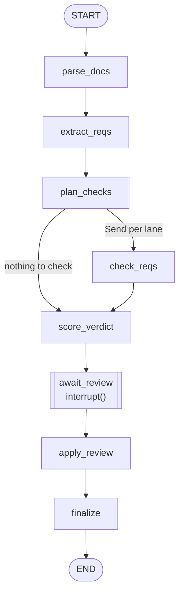
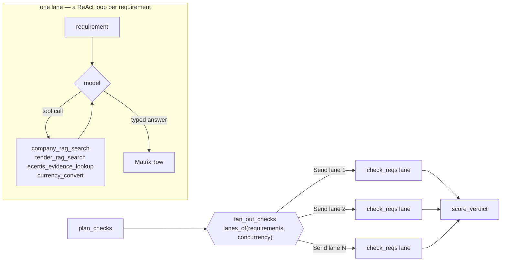
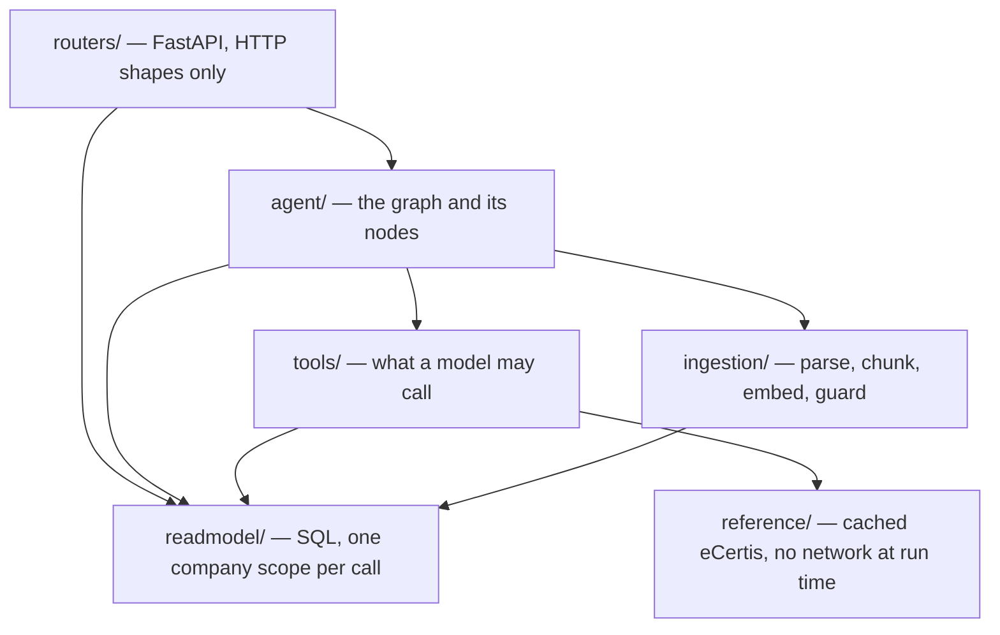

# Architecture

**S7.3.** What Crossbid is made of, for a reader who knows LangGraph and has not seen this
repository. Every node is named with what it reads and what it writes, so the graph can be
followed without opening the code. `docs/project-plan.md` owns scope and build order;
`docs/decisions.md` owns why each choice was made; this file owns the shape.

---

## Workflow or agent? Both, and the boundary is deliberate

The course brief asks for an agent, and a fair answer has to say which parts of this system
actually are one.

**The outer graph is a deterministic workflow, not an agent.** Its eight nodes run in a fixed
order written in `agent/graph.py`; no model chooses the next step, and the only branch in the
whole graph is arithmetic — `fan_out_checks` divides the requirements into lanes and sends one
`Send` per lane, or routes straight to scoring when there are none. A model cannot skip
review, cannot re-run extraction, and cannot reach the database. That is a design choice
rather than a limitation: the product's promise is that a human gates every verdict, and a
graph whose control flow a model can influence cannot make that promise.

**The agentic part is inside one node.** `check_reqs` runs a ReAct loop *per requirement*
(`agent/nodes/check_loop.py`): the model is given four tools, decides for itself which to
call and in what order, reads the results, and decides when it has enough to answer. It is
bounded by `agent.max_tool_calls_per_requirement`, and the loop's output is a typed
`MatrixRow`, never prose. So the autonomy is real — tool selection, query formulation, and
when to stop are all the model's — and it is confined to a node that can only ever produce
one row of a matrix a human then reviews.

**"Ask the tender" is a second, smaller agent** (`agent/chat_graph.py`), the same pattern over
three tools, answering one question on its own thread.

A one-sentence version: *a deterministic pipeline with a human interrupt, whose checking step
is a bounded per-requirement ReAct agent.*

---

## The outer graph

Compiled on a Postgres checkpointer, so a run interrupted by a restart resumes from its last
completed node (`agent/runner.py:resume_unfinished_runs`). Every node is wrapped by
`graph.stage`, which writes the bid's status to the read model before the node runs, attributes
every model call this node makes to the cost table, and turns any exception into a
`StageError` naming the stage — so a failure reads as "parsing failed" on the dashboard rather
than as a traceback.

### The nodes

| Node | Reads from state | Writes to state | Model? |
|---|---|---|---|
| `parse_docs` | `company_id`, `bid_id`, `source_language` | `documents`, `extraction_problems`, `requirements`¹ | no |
| `extract_reqs` | `documents`, `bidder_language` | `requirements`, `extraction_problems` | **yes** — `extract` |
| `plan_checks` | `company_id` | `bidder_country` | no |
| `check_reqs` | one lane of `requirements`, `bidder_country` | `matrix_rows` | **yes** — `cheap`, in a ReAct loop |
| `score_verdict` | `requirements`, `matrix_rows`, company profile | `verdict`, `matrix_rows`² | no |
| `await_review` | `verdict`, `matrix_rows` | `review` | no |
| `apply_review` | `review`, `matrix_rows` | `matrix_rows`, `agent_verdict`, `verdict` | no |
| `finalize` | `review` | `decision` | no |

¹ Only when the pack contains a published ESPD request (DUME). Its criteria are already typed
and already carry canonical eCertis ids, so the node that reads the XML is the node that knows
them and no model is asked anything (S2.5.1).

² `score_verdict` writes the matrix back because it is the only node holding the company
profile and the whole matrix at once, which is what the reviewer notices need (`agent/flags.py`).
A notice only ever changes a rationale, never a status.

**Three of eight nodes call a model.** The other five are file parsing, arithmetic, and
database writes.

### How state is combined

`BidState` is a `TypedDict` whose channels declare their own reducers, which is what makes the
fan-out safe:

- `requirements` and `extraction_problems` use `operator.add` — lanes and nodes append.
- `matrix_rows` uses `merged_rows` — a later write **replaces** a row with the same id rather
  than doubling it, which is why `score_verdict` can hand back a flagged matrix.
- `status` uses `latest_status` — the most recent write wins. It exists because a plain
  channel refuses two writes in one superstep and the fan-out produces exactly that: every
  lane runs in one superstep and every lane's stage wrapper merges the same `status` into its
  update. So it is not a race between two answers; it is one answer arriving several times.

---

## The `check_reqs` fan-out

`agent.check_concurrency` (default 5) sets how many lanes run at once. `lanes_of` deals the
requirements round-robin into `min(concurrency, len(requirements))` lanes — never more lanes
than there is work for — and each lane walks its own list, so the setting bounds concurrent
model calls rather than partitioning the work by document.

**Two keys open a tool** (ADR-0052). `build_enabled_tools(context, settings, needed=, caller=)`
returns `enabled_tools ∩ needed`: the operator's list in settings may not be widened by code,
and a node may not be handed the whole toolbox by forgetting to narrow. `check_reqs` declares
four; the chat graph declares three.

**A checking loop that cannot settle a requirement says so.** `Checkability` is decided at
extraction: only `company_property` rows are worth tool calls, because no corpus of company
facts can establish "we submitted form X". A `document_submission` row goes to the reviewer as
"attach this" without a model ever being asked (ADR-0003).

---

## Layers, and what may call what

The rule a reader should take away: **a node never runs SQL and never opens a connection.** It
is built from collaborators — a loader, a fetcher, a parser, a writer — which is what lets the
whole graph be exercised offline over fakes, and is why `crossbid/eval/packrun.py` can run a
real extraction with no database at all.

---

## Untrusted input, everywhere it enters

Tender text is written by somebody else and is treated as data at every boundary.

- **At the prompt**: every document passage is wrapped in a delimited block whose markers carry
  a one-time tag generated after the document was read (`guards/wrap.py`). Any instruction
  inside the block that does not carry that tag is content, not a command, and the system
  prompt says so as well.
- **At ingestion**: chunks are scanned for planted instructions before anything is embedded,
  and a flagged chunk gets a cheap-model second opinion that may only ever say "let it
  through" (ADR-0049, ADR-0054).
- **The asymmetry is the design**: a flagged chunk is *withheld* from the retrieval corpus and
  the same document is still *extracted in full*. Dropping its pages would let an attacker
  delete the requirement they least want checked. `ingestion/guarding.py` holds the rule once
  for both corpora.
- **At the type**: quotes are length-bounded where they are defined, tool outputs are
  schema-validated, and `Requirement` refuses a row from a paginated source with no page.

---

## Persistence

| What | Where | Why there |
|---|---|---|
| Checkpoints | `AsyncPostgresSaver` (Supabase) | a restart resumes an interrupted run |
| Read model | `bids`, `requirements`, `matrix_rows`, `llm_usage`, … | what the browser polls; the graph never reads it back |
| Vectors | `company_chunks`, `tender_chunks` (pgvector, 1536 dims) | retrieval for both RAG tools |
| Files | Supabase Storage, prefix per company, signed URLs | the pack and the evidence pack |

`tender_chunks` is written by `parse_docs` rather than at upload, because a tender document is
uploaded before its bid exists and the column is `NOT NULL` (ADR-0057).

**Tenancy is application-level, not RLS.** The API connects as a role with `BYPASSRLS`, so the
`company_id` predicate in every statement is the entire boundary between two companies
(ADR-0009). That is why the read model's methods take `company_id` as a keyword with no
default, why the SQL is `Final[LiteralString]` constants the type checker will not let anyone
build at run time, and why `tests/integration/test_read_model_round_trip.py` asserts the
separation against a real Postgres rather than by grepping a string.

---

## Evaluation (S7.1)

The suite has no privileged access: it drives the same graph, the same chat agent and the same
tools a bidder reaches.

| Metric | Needs a model? | Where |
|---|---|---|
| Requirement recall | no — set arithmetic against a verified key | `eval/recall.py` |
| Citation faithfulness | no — the extractor's own verbatim predicate, re-run over independently parsed PDFs | `eval/faithfulness.py` |
| Translation adequacy | **yes** — DeepEval `GEval` | `eval/translation.py` |
| Retrieval (4 ragas metrics) | **yes** | `eval/retrieval.py` |

The judge is from a different vendor than every model under test. Extraction and chat run on
OpenAI slugs through OpenRouter; the judge is Google's. `evaluations/REPORT.md` is assembled
offline from saved artefacts, and names any metric it could not measure.
