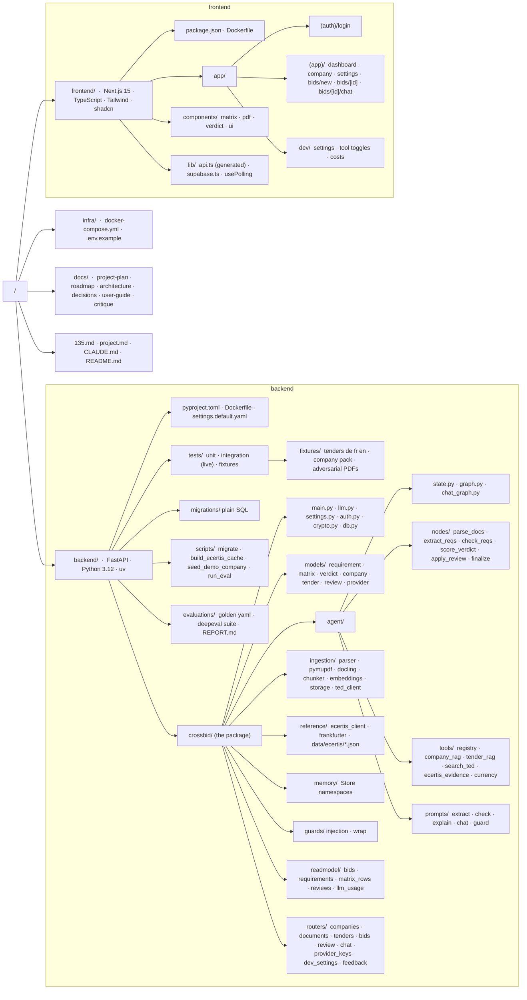
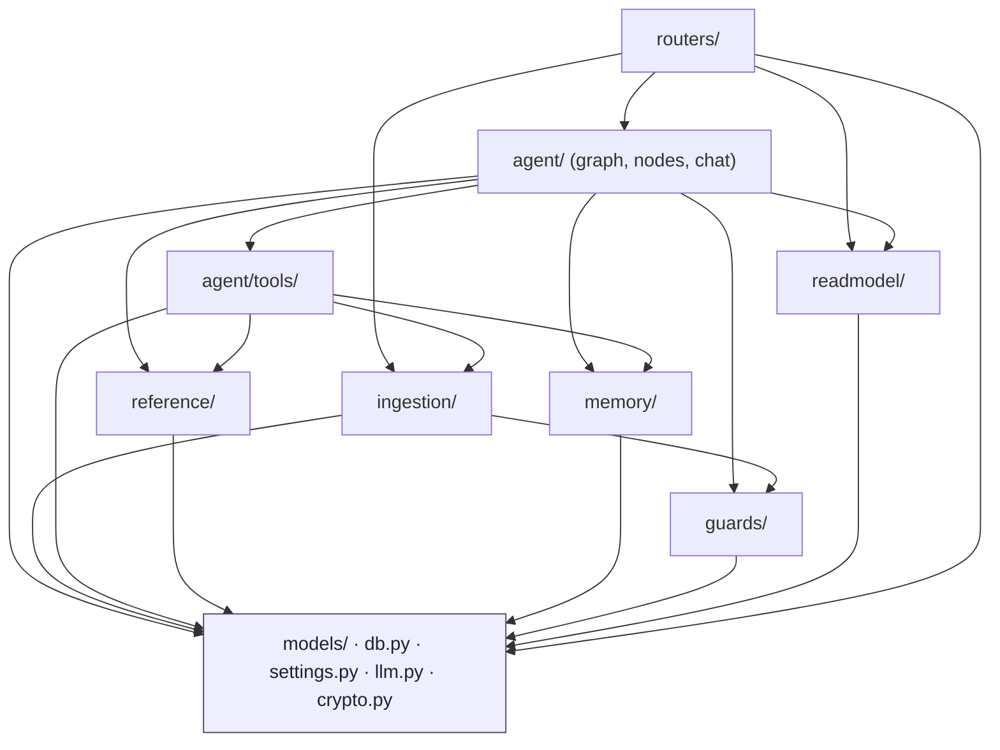
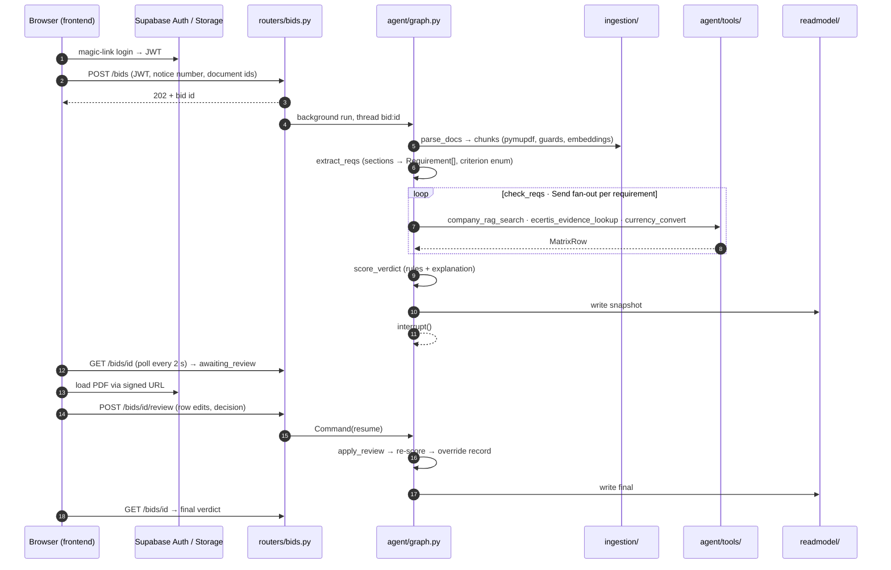
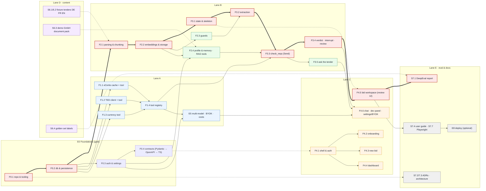
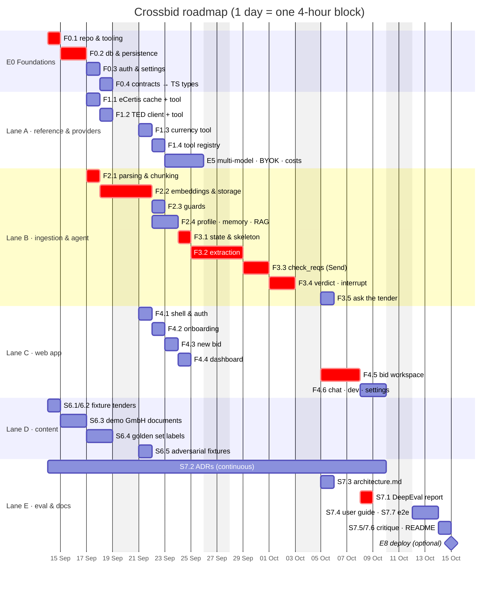

# Crossbid — structure and roadmap

Visual companion to `project-plan.md`. Diagrams are Mermaid fences, so they render in GitHub, VS Code (Markdown Preview Mermaid Support), and any MDX site with a Mermaid plugin. Sizes: S about 1 h, M about 2 h, L about 4 to 5 h. One roadmap "day" is a 4-hour block.

## 1. Folder structure

## 2. Dependency direction inside the backend

Arrows mean "may import from". Nothing points upward.

## 3. One bid, across the folders

## 4. Feature dependency graph and critical path

Feature-level (stories roll up). Thick red edges are the critical path. Dashed edges are content or contract inputs that carry no code dependency.

## 5. Roadmap by lane

Feature-level Gantt. Dates are placeholders from a nominal start on 2026-09-14; only the ordering and overlaps matter. Lane D starts before E0 is finished because it has no code dependency.

## 6. Story board

Order inside each lane is the intended execution order. `needs` lists hard prerequisites outside the lane.

| Lane | Order | Story | Size | needs |
|---|---|---|---|---|
| gate | 1 | S0.1.1 layout, uv, create-next-app, shadcn | S | — |
| gate | 2 | S0.1.2 docker-compose, env, task runner | M | — |
| gate | 3 | S0.1.3 ruff, pyright, pytest, eslint, pre-commit, `make deps` / `deps-check` guard | M | — |
| gate | 4 | S0.2.1 Supabase EU project, bucket, migrations runner | M | — |
| gate | 5 | S0.2.2 db.py pool, checkpointer + store factories | M | S0.2.1 |
| gate | 6 | S0.2.3 read-model tables incl. provider_keys, llm_usage | M | S0.2.1 |
| gate | 7 | S0.3.1 Supabase Auth, JWT deps, is_developer | M | S0.2.1 |
| gate | 8 | S0.3.2 settings.default.yaml, llm.py factory (OpenRouter) | S | — |
| gate | 9 | S0.3.3 LangSmith wiring | S | — |
| gate | 10 | S0.4.1 Pydantic contracts and enums | M | — |
| gate | 11 | S0.4.2 router stubs, openapi-typescript → api.ts | S | S0.4.1 |
| A | 1 | S1.1.1 build_ecertis_cache.py | M | S0.1 |
| A | 2 | S1.1.2 ecertis_evidence_lookup tool | M | S1.1.1 |
| A | 3 | S1.1.3 criterion enum from cache | S | S1.1.1 |
| A | 4 | S1.2.1 ted_client (expert query, no OR in IN) | M | — |
| A | 5 | S1.2.2 search_ted tool, GET /tenders/search | S | S1.2.1 |
| A | 6 | S1.3.1 Frankfurter client, currency_convert | S | — |
| A | 7 | S1.4.1 tool registry with manifests | M | tools above |
| A | 8 | S5.1 vendor slug switching inside OpenRouter | M | S1.4.1 |
| A | 9 | S5.4 BYOK backend: crypto, provider_keys, verify-on-save | M | S0.2.3, S0.3.1 |
| A | 10 | S5.5 BYOK factory: resolve(company, role) with fallback | M | S5.4 |
| A | 11 | S5.6 cost accounting for direct providers, llm_usage | S | S5.5 |
| A | 12 | S5.2 LangSmith metadata, GET /dev/costs | M | S5.6 |
| A | 13 | S5.3 luna injection classifier on flagged chunks | S | S2.3.1 |
| B | 1 | S2.1.1 Parser protocol, pymupdf parser | M | S0.1 |
| B | 2 | S2.1.3 chunker 800/100 | S | S2.1.1 |
| B | 3 | S2.2.1 embeddings via OpenRouter, pgvector helpers | M | S0.2.2 |
| B | 4 | S2.2.2 Storage upload, signed URLs | M | S0.2.1 |
| B | 5 | S2.2.3 POST /documents pipeline | M | S2.2.1, S2.2.2 |
| B | 6 | S2.3.1 injection heuristics | M | S6.5 |
| B | 7 | S2.3.2 data-block wrapper | S | — |
| B | 8 | S2.3.3 slowapi limits | S | — |
| B | 9 | S2.4.1 company profile endpoints, Store namespace | M | S0.3.1 |
| B | 10 | S2.4.2 company_rag_search, tender_rag_search tools | M | S2.2.1 |
| B | 11 | S2.4.3 seed_demo_company.py | M | S6.3 |
| B | 12 | S2.1.2 Docling parser (switchable) | M | S2.1.1 |
| B | 13 | S3.1.1 BidState, graph skeleton, POST/GET bids | M | S0.2.2 |
| B | 14 | S3.2.2 fold TED notice fields into requirements | S | S1.2.1 |
| B | 15 | S3.2.1 extract_reqs sections + dedupe | L | S1.1.3 |
| B | 16 | S3.3.1 check_reqs Send fan-out | L | S1.4.1, S2.4.2 |
| B | 17 | S3.3.2 fake-model tests per status branch | M | S3.3.1 |
| B | 18 | S3.4.1 score_verdict rules + explanation | M | S3.3.1 |
| B | 19 | S3.4.2 interrupt, apply_review, POST review | M | S3.4.1 |
| B | 20 | S3.4.3 read-model writers | M | S3.4.2 |
| B | 21 | S3.4.4 failure handling | M | S3.4.2 |
| B | 22 | S3.5.1 chat_graph, POST chat | M | S2.4.2, S3.4.3 |
| C | 1 | S4.1.1 Supabase client, login, API client | M | S0.4.2 |
| C | 2 | S4.1.2 layout, nav, theme | S | S4.1.1 |
| C | 3 | S4.2.1 company profile form | M | S4.1.1 |
| C | 4 | S4.2.2 document upload with status | M | S4.1.1 |
| C | 5 | S4.3.1 TED search → pick → upload → start | M | S4.1.1 |
| C | 6 | S4.4.1 dashboard | M | S4.1.1 |
| C | 7 | S4.5.1 workspace two-pane, react-pdf, polling | L | S3.1.1 |
| C | 8 | S4.5.2 matrix rows editor, evidence, eCertis card | L | S3.4.3 |
| C | 9 | S4.5.3 verdict panel, confirm/override | M | S3.4.2 |
| C | 10 | S4.6.4 Settings → AI provider (BYOK) page | M | S5.4 |
| C | 11 | S4.6.1 chat page | M | S3.5.1 |
| C | 12 | S4.6.2 /dev panel | M | S5.2 |
| C | 13 | S4.6.3 feedback thumbs | S | — |
| D | 1 | S6.1 DE + FR fixture tenders, SOURCES.md | M | — |
| D | 2 | S6.2 EN golden tender | M | — |
| D | 3 | S6.3 demo GmbH document pack | L | — |
| D | 4 | S6.5 adversarial injection PDFs | S | — |
| D | 5 | S6.4 golden set labels (LLM-assisted, verified) | L | S6.1, S6.2 |
| E | ∞ | S7.2 ADRs, one per decision as it lands | S each | — |
| E | 1 | S7.3 architecture.md | M | S3.4 |
| E | 2 | S7.1 DeepEval suite + REPORT.md | M | E3, S6.4 |
| E | 3 | S7.7 Playwright smoke test | M | E4 |
| E | 4 | S7.4 user guide, three worked examples | M | E4 |
| E | 5 | S7.5 critique.md | S | — |
| E | 6 | S7.6 README, trim project.md, CLAUDE.md commands | S | — |
| E | 7 | S8.1 deploy (optional) | M | all |
