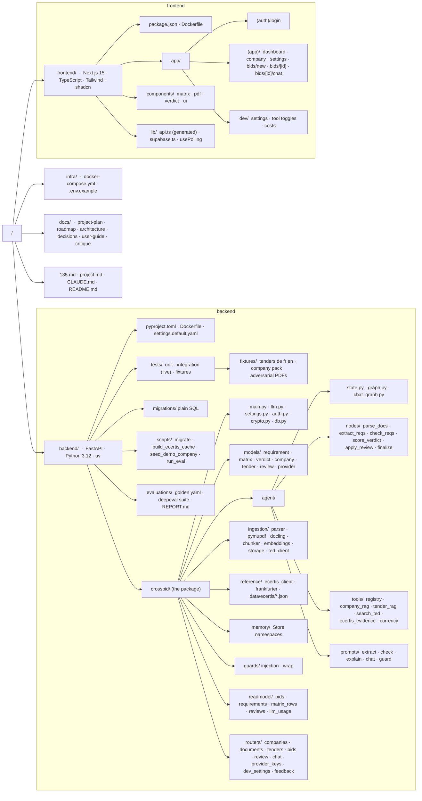
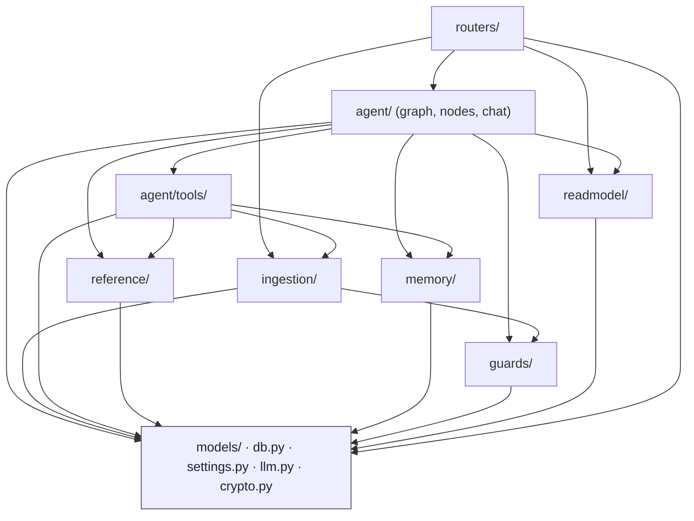
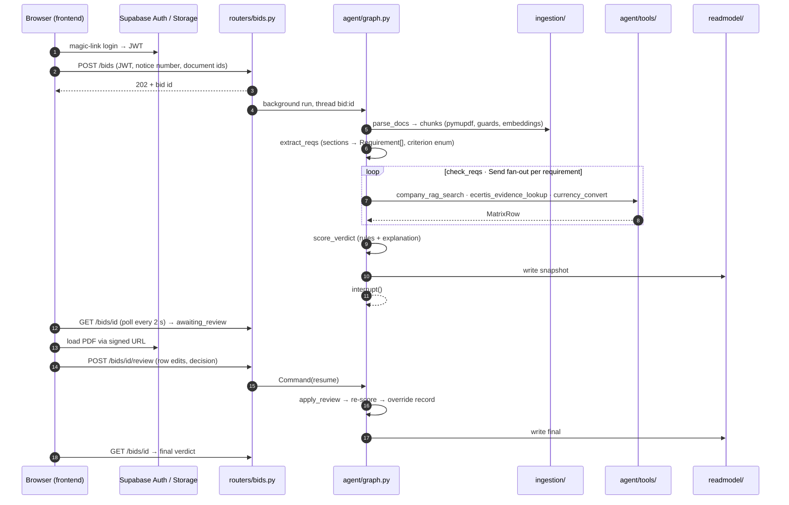
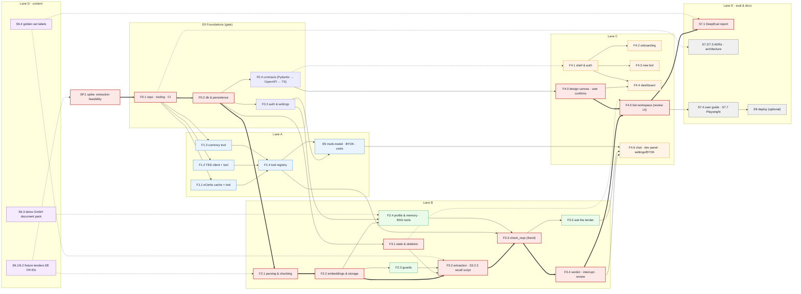
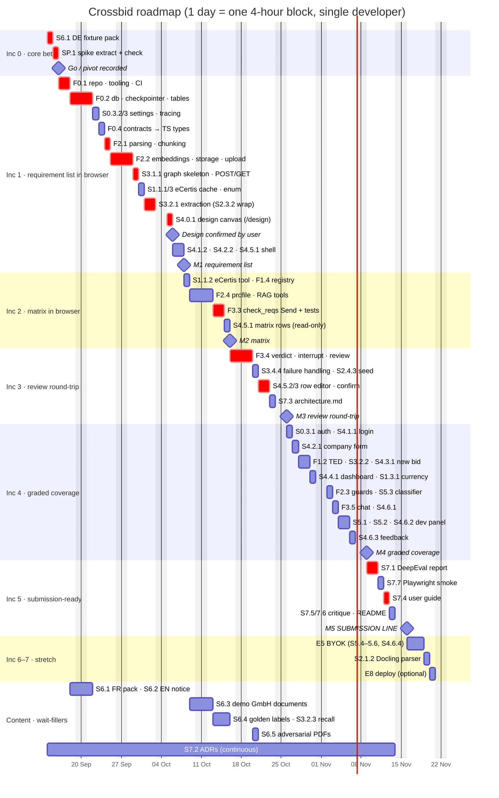

# Crossbid — structure and roadmap

Visual companion to `project-plan.md`. Diagrams are Mermaid fences, so they render in GitHub and in VS Code (Markdown Preview Mermaid Support). Sizes use the plan's scale: S about 1 h, M 1–3 h, L 3–6 h. One roadmap "day" is a 4-hour block. Lanes A–E are tags for grouping only; one developer builds this, so the Gantt is a single track ordered by increment (see *Delivery order* in the plan).

## 1. Folder structure

## 2. Dependency direction inside the backend

Arrows mean "may import from". Nothing points upward.

## 3. One bid, across the folders

## 4. Feature dependency graph and critical path

Feature-level (stories roll up). Thick red edges are the critical path. Dashed edges are content or contract inputs that carry no code dependency. Corrections from the PM review of 2026-09-10: F1.x depend on the repo (F0.1), not the database; F3.1 depends on the checkpointer (F0.2), not on F2.4; F0.3 (auth) is no longer on the path to F0.4; the spike precedes everything.

## 5. Roadmap by increment (single track)

Dates are placeholders from a nominal start on 2026-09-14; only the order matters. One row per feature-sized chunk, sequential, because one person does the work. The *content* section shows wait-fillers that run inside gaps of the same blocks, not in extra time. The milestone after Increment 5 is the submission line; Increments 6 and 7 are stretch.

## 6. Story board

Sorted by increment (the plan's *Delivery order*); lane is a grouping tag only. `needs` lists hard prerequisites. Priority Could rows are never started before the submission line (end of Increment 5).

| Inc | Lane | Story | Size | Priority | needs |
|---|---|---|---|---|---|
| 0 | gate | SP.1 spike: extract + check on DE fixture, recall figure, go/pivot ADR | M | Must | S6.1 (DE) |
| 0 | D | S6.1 DE + FR fixture tenders, SOURCES.md | M | Must | — |
| 1 | gate | S0.1.4 GitHub Actions: lint, types, pytest ≥80% cov, deps-check, api.ts drift | M | Must | S0.1.3 |
| 1 | gate | S0.1.1 layout, uv, create-next-app, shadcn | S | Must | — |
| 1 | gate | S0.1.2 docker-compose, env, task runner | M | Must | — |
| 1 | gate | S0.1.3 ruff, pyright, pytest, eslint, pre-commit, `make deps` / `deps-check` guard | M | Must | — |
| 1 | gate | S0.2.1 Supabase EU project, bucket, migrations runner | M | Must | — |
| 1 | gate | S0.2.2 db.py pool, checkpointer + store factories | M | Must | S0.2.1 |
| 1 | gate | S0.2.3 read-model tables incl. provider_keys, llm_usage | M | Must | S0.2.1 |
| 1 | gate | S0.3.2 settings.default.yaml, llm.py factory (OpenRouter) | S | Must | — |
| 1 | gate | S0.3.3 LangSmith wiring | S | Must | — |
| 1 | gate | S0.4.1 Pydantic contracts and enums | M | Must | — |
| 1 | gate | S0.4.2 router stubs, openapi-typescript → api.ts | S | Must | S0.4.1 |
| 1 | A | S1.1.1 build_ecertis_cache.py | M | Must | S0.1 |
| 1 | A | S1.1.3 criterion enum from cache | S | Must | S1.1.1 |
| 1 | B | S2.1.1 Parser protocol, pymupdf parser | M | Must | S0.1 |
| 1 | B | S2.1.3 chunker 800/100 | S | Must | S2.1.1 |
| 1 | B | S2.2.1 embeddings via OpenRouter, pgvector helpers | M | Must | S0.2.2 |
| 1 | B | S2.2.2 Storage upload, signed URLs | M | Must | S0.2.1 |
| 1 | B | S2.2.3 POST /documents pipeline | M | Must | S2.2.1, S2.2.2 |
| 1 | B | S2.3.2 data-block wrapper | S | Must | — |
| 1 | B | S3.1.1 BidState, graph skeleton, POST/GET bids | M | Must | S0.2.2 |
| 1 | B | S3.2.1 extract_reqs sections + dedupe | L | Must | S1.1.3, S2.3.2 (recall via S3.2.3) |
| 1 | C | S4.0.1 design canvas via `/design`; user confirms before workspace components are coded | M | Must | S0.4.1 |
| 1 | C | S4.1.2 layout, nav, theme | S | Must | S0.4.2 (hand-written types ok) |
| 1 | C | S4.2.2 document upload with status | M | Must | S4.1.2, S2.2.3 |
| 1 | C | S4.5.1 workspace two-pane, react-pdf, polling (matrix-row criterion finishes in Inc 2) | L | Must | S3.1.1, S4.0.1 |
| 1 | D | S6.2 EN golden tender | M | Must | — |
| 2 | B | S3.2.3 recall script against golden labels (reused by S7.1) | S | Must | S3.2.1, S6.4 |
| 2 | A | S1.1.2 ecertis_evidence_lookup tool | M | Must | S1.1.1 |
| 2 | A | S1.4.1 tool registry with manifests | M | Must | S1.1.2, S2.4.2 (S1.2.2, S1.3.1 join in Inc 4) |
| 2 | B | S2.4.1 company profile endpoints, Store namespace | M | Must | S0.2.3 (dev auth until S0.3.1) |
| 2 | B | S2.4.2 company_rag_search, tender_rag_search tools | M | Must | S2.2.1 |
| 2 | B | S3.3.1 check_reqs Send fan-out | L | Must | S1.4.1, S2.4.2 |
| 2 | B | S3.3.2 fake-model tests per status branch | M | Must | S3.3.1 |
| 2 | D | S6.3 demo GmbH document pack | L | Must | — |
| 2 | D | S6.4 golden set labels (LLM-assisted, verified) | L | Must | S6.1, S6.2 |
| 3 | B | S2.4.3 seed_demo_company.py | M | Must | S6.3 |
| 3 | B | S3.4.1 score_verdict rules + explanation | M | Must | S3.3.1 |
| 3 | B | S3.4.2 interrupt, apply_review, POST review | M | Must | S3.4.1 |
| 3 | B | S3.4.3 read-model writers | M | Must | S3.4.2 |
| 3 | B | S3.4.4 failure handling | M | Must | S3.4.2 |
| 3 | C | S4.5.2 matrix rows editor, evidence, eCertis card | L | Must | S3.4.3, S4.0.1 |
| 3 | C | S4.5.3 verdict panel, confirm/override | M | Must | S3.4.2, S4.0.1 |
| 3 | D | S6.5 adversarial injection PDFs | S | Must | — |
| 3 | E | S7.3 architecture.md | M | Must | S3.4 |
| 4 | gate | S0.3.1 Supabase Auth, JWT deps, is_developer | M | Must | S0.2.1 |
| 4 | A | S1.2.1 ted_client (expert query, no OR in IN) | M | Must | — |
| 4 | A | S1.2.2 search_ted tool, GET /tenders/search | S | Must | S1.2.1 |
| 4 | A | S1.3.1 Frankfurter client, currency_convert | S | Must | — |
| 4 | A | S5.1 vendor slug switching inside OpenRouter | M | Must | S1.4.1 |
| 4 | A | S5.2 LangSmith metadata, GET /dev/costs | M | Must | S0.3.2 |
| 4 | A | S5.3 luna injection classifier on flagged chunks | S | Must | S2.3.1 |
| 4 | B | S2.3.1 injection heuristics | M | Must | S6.5 |
| 4 | B | S2.3.3 slowapi limits | S | Must | — |
| 4 | B | S3.2.2 fold TED notice fields into requirements | S | Must | S1.2.1 |
| 4 | B | S3.5.1 chat_graph, POST chat | M | Must | S2.4.2, S3.4.3 |
| 4 | C | S4.1.1 Supabase client, login, API client | M | Must | S0.4.2 |
| 4 | C | S4.2.1 company profile form | M | Must | S4.1.1 |
| 4 | C | S4.3.1 TED search → pick → upload → start | M | Must | S4.1.1 |
| 4 | C | S4.4.1 dashboard | M | Must | S4.1.1, S4.0.1 |
| 4 | C | S4.6.1 chat page | M | Must | S3.5.1 |
| 4 | C | S4.6.2 /dev panel | M | Must | S5.2 |
| 4 | C | S4.6.3 feedback thumbs | S | Must | — |
| 5 | E | S7.1 DeepEval suite + REPORT.md | M | Must | E3, S6.4 |
| 5 | E | S7.7 Playwright smoke test | M | Must | E4 Must stories |
| 5 | E | S7.4 user guide, three worked examples | M | Must | E4 Must stories |
| 5 | E | S7.5 critique.md | S | Must | — |
| 5 | E | S7.6 README, trim project.md, CLAUDE.md commands | S | Must | — |
| 6 | A | S5.4 BYOK backend: crypto, provider_keys, verify-on-save | M | Could | S0.2.3, S0.3.1 |
| 6 | A | S5.5 BYOK factory: resolve(company, role) with fallback | M | Could | S5.4 |
| 6 | A | S5.6 cost accounting for direct providers, llm_usage | S | Could | S5.5 |
| 6 | B | S2.1.2 Docling parser (switchable) | M | Could | S2.1.1 |
| 6 | C | S4.6.4 Settings → AI provider (BYOK) page | M | Could | S5.4 |
| 7 | E | S8.1 deploy (optional) | M | Optional | all |
| all | E | S7.2 ADRs, one per decision as it lands | S each | Must | — |
