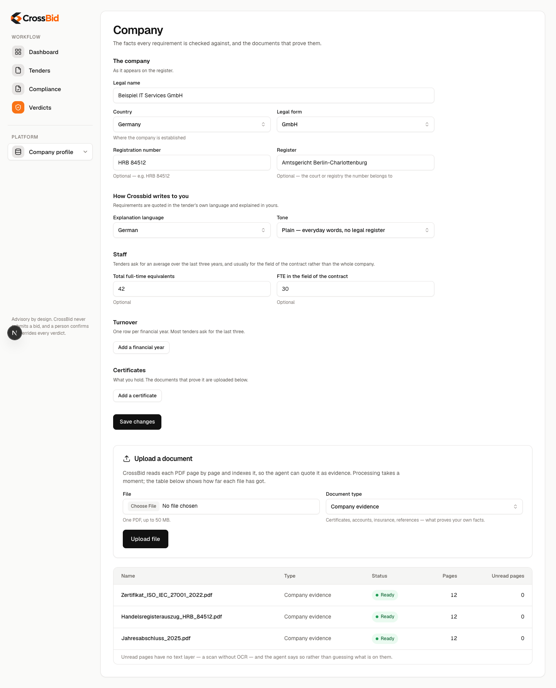
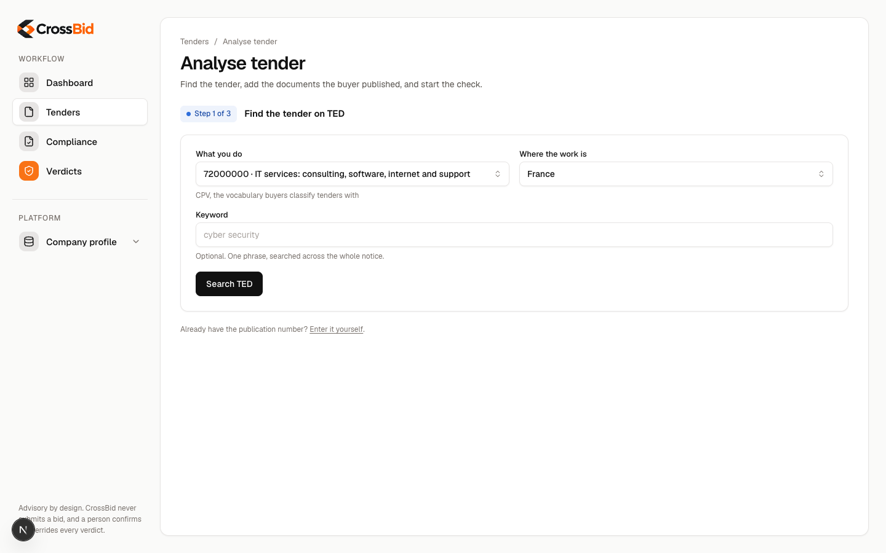
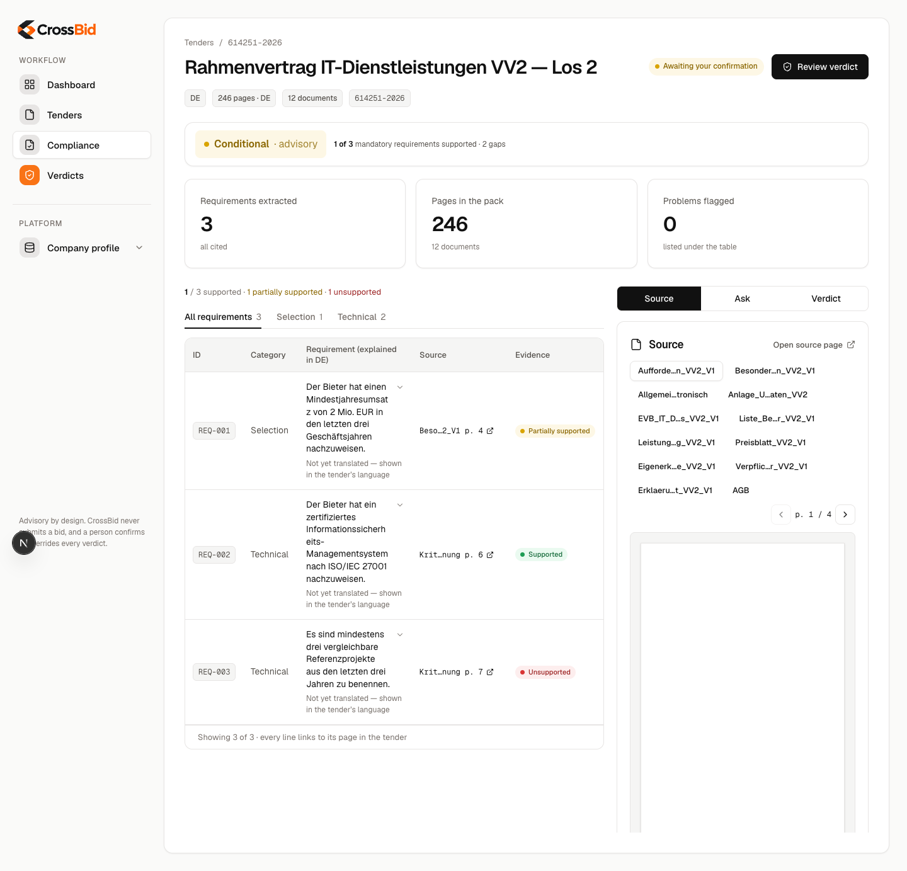
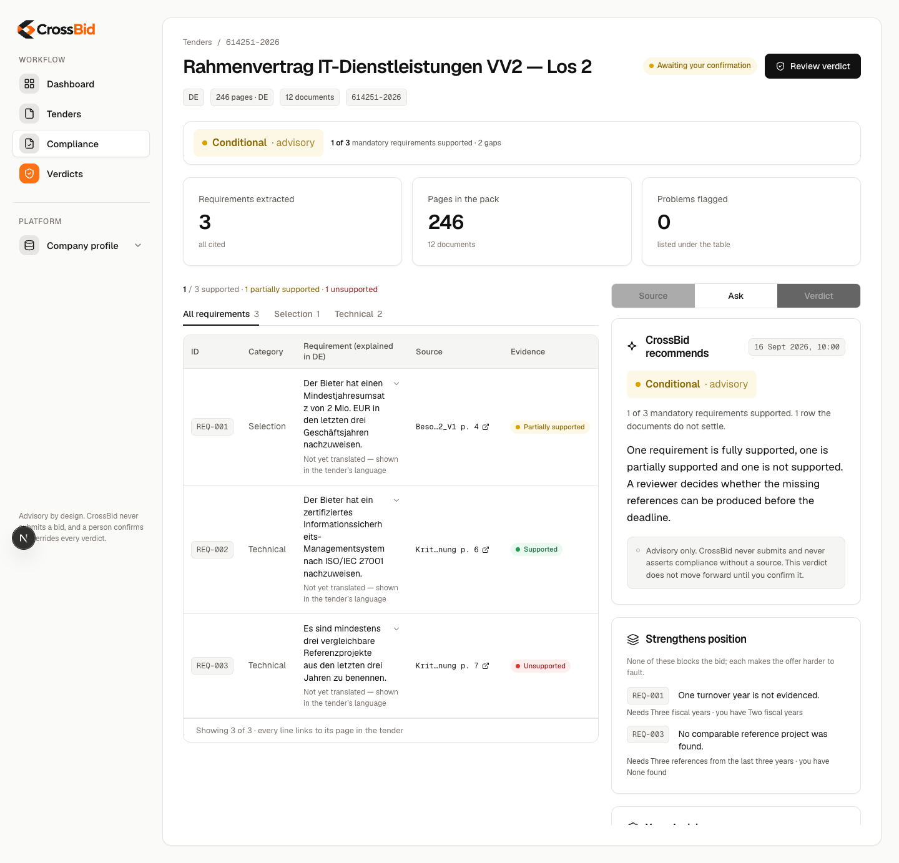
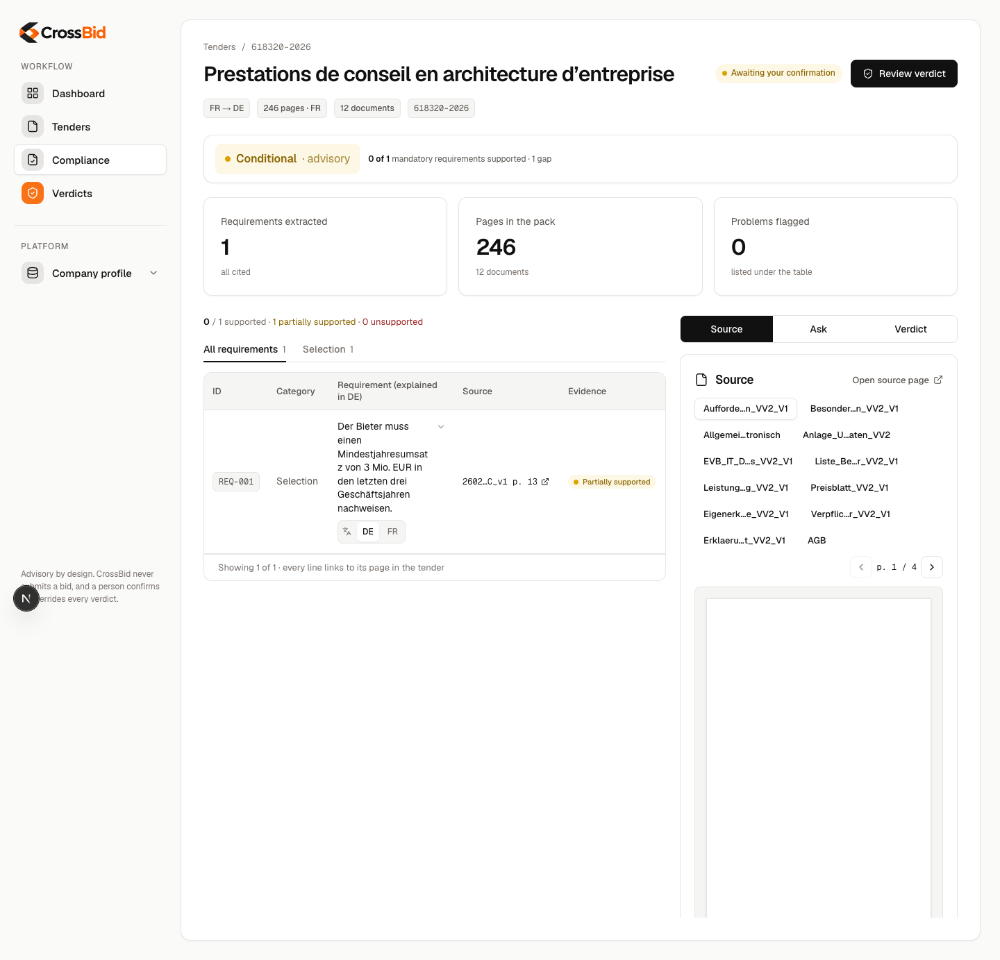
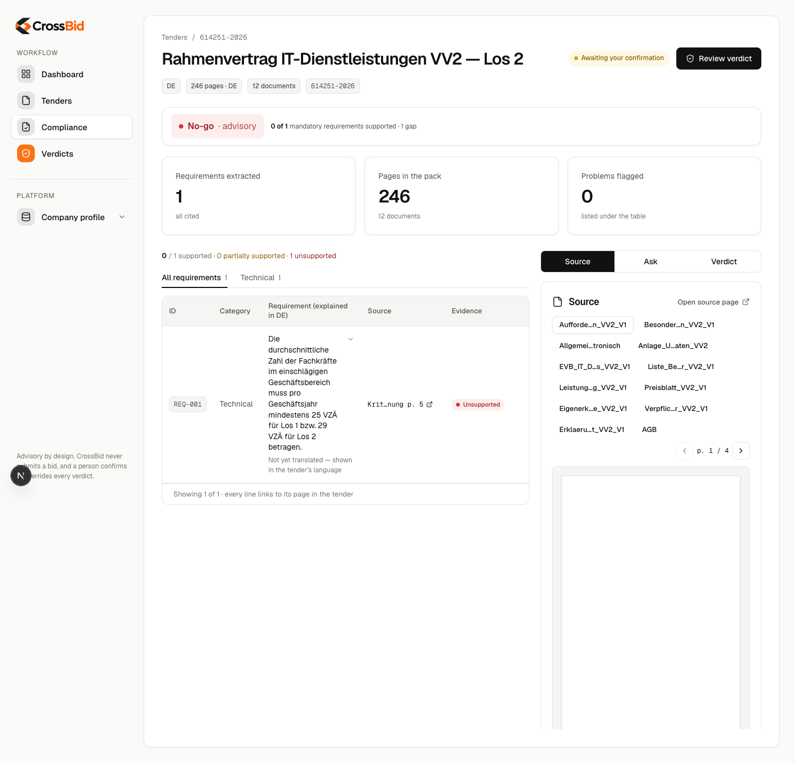

# Crossbid — user guide

**S7.4.** How to run your first bid, and how to read what comes back. Three worked examples: a
German domestic tender, a French tender read in German, and a bid the agent recommends against.

Crossbid is **advisory**. It never submits anything, every cell of the matrix carries a citation
or is marked as unsupported, and a person confirms or overrides every verdict before it is
final. Nothing in this guide changes that.

> **About the screenshots.** The images below are the real interface, driven by
> `npm run guide:shots` against typed fixture data — so anyone can regenerate them with no
> database, no API key and no money, and a renamed field breaks the capture rather than leaving
> a stale picture in this file. Where an image comes from a **live run** against real services
> it says so underneath.

---

## Before your first bid

You need three things in place. Each is a screen, and each takes a few minutes once.

### 1. An account

Sign in at `/login` with a password, or ask for a magic link. Registration and password reset
are on the same screen. If you are running Crossbid locally in developer mode, sign-in is
skipped and your company is set by an environment variable.

### 2. Your company profile

`/company` is where Crossbid learns who is bidding. Fill in the legal facts — name, country,
legal form, registration — and then the figures tenders actually ask about: staff in
full-time equivalents, staff in the field of the contract, and turnover per year.

**The figures are not decoration.** A tender demanding "at least €3,000,000 annual turnover
over the last three fiscal years" is checked against these numbers arithmetically, not by
asking a model. If they are wrong or missing, the agent says a requirement is unsupported when
it may not be.

### 3. Your evidence pack

On the same screen, upload the documents that prove those claims: certificates, annual
accounts, insurance, references, register extracts. Each is parsed page by page and indexed, so
the agent can **quote** them rather than paraphrase.

Wait for each to read **Ready**. A document still parsing is not yet searchable, and a bid
started before it finishes will be checked without it.

**"Ready" does not always mean every page of it is searchable.** Each upload is scanned for
text that looks like an instruction planted in the document rather than content — a real
attack on a system that reads documents and acts on them. A passage that trips the scanner is
withheld from the searchable corpus, and the document still becomes *Ready* with the withheld
passages counted on it. That matters for one reason: for a document with withheld passages,
"no evidence found" means "not found in what was searched", which is not the same sentence. If
a document you know proves something comes back as not proving it, check whether any of its
passages were withheld.

---

## Example 1 — a German tender, a German bidder

The base case: a German GmbH bidding on a German framework contract.

### Find the tender and start

`/bids/new` searches TED, the EU's official tender database, by CPV code and keyword. Pick the
notice, and Crossbid carries its buyer and its deadline's time zone onto the bid.

**You still type the deadline date and hour.** TED publishes a date with a UTC offset and no
time of day, so the hour is yours to supply — it is on the notice PDF, and getting it wrong is
the one field that cannot be recovered later.

Upload the procurement documents for this tender — the notice PDF and everything the buyer
published — and press start.

### Watch it work

The bid moves through parsing, extraction and checking. This takes a few minutes on a large
pack; the page polls, so leave it open. The German fixture pack used in testing is 29 documents
and about 200 pages, and reaches review in roughly five minutes.

### Read the matrix

One row per requirement the tender places on you. Four things to read:

- **The requirement**, as the tender words it, with the document and page it came from. Click
  the citation to open that page in the panel on the right. Every row has one — an
  uncited requirement is not something Crossbid will show you.
- **The evidence status**, which is the agent's answer, one of four words:
  - **Supported** — a document of yours settles it, and the row says which and where.
  - **Partially supported** — some of it is evidenced and some is not. This is the honest
    middle, and it never decides against you on its own.
  - **Unsupported** — nothing in your pack settles it. One of these on a mandatory
    requirement is what makes a verdict *no-go*.
  - **Not applicable** — the requirement does not bind you.
- **The tabs** above the table, which narrow to selection criteria or technical criteria.
- **Problems flagged**, under the table: pages that could not be read, or text that looked
  like an instruction planted in the document rather than a requirement.

### Read the verdict

The banner gives the agent's recommendation — **go**, **conditional**, **no-go**, or
**insufficient evidence** — with the count of mandatory requirements supported and the gaps
that remain. Each gap names what was required and what you actually have.

**The verdict is advisory and is labelled so.** Open *Review verdict* to go through the matrix
row by row: change a status, give a reason, attach a document. Your edits are held locally
until you confirm, and the agent's original answer stays visible beside yours the whole time.
Confirm, and the scorer re-runs on your statuses — so the final verdict is scored from what you
decided, not from what the agent guessed.

### Ask the tender

The **Ask** tab beside the source panel answers questions about this tender in your language —
*"what is the deadline for questions?"*, *"which form do I need for subcontractors?"* Every
answer carries citations, and clicking one opens the page it came from. An answer it cannot
cite comes back saying so rather than guessing.

---

## Example 2 — a French tender, a German bidder

This is what Crossbid is for. The tender is written in French, you are not, and the evidence
you hold is German.

Three things change, and nothing else does.

- **The badge reads `FR → DE`.** Every requirement is extracted in the tender's own language,
  quoted verbatim, and explained in yours. The quote is never translated in place — the
  citation has to survive.
- **Each row carries a language toggle.** `DE` shows you the explanation; `FR` shows you the
  clause the buyer actually wrote, which is the one that binds you.
- **Where the buyer published a structured ESPD request (a DUME), criterion mapping needs no
  guessing.** Those requirements arrive with a canonical EU criterion id already attached, and
  Crossbid looks up what evidence your own country accepts for that criterion — so a French
  demand for a probity certificate resolves to the German *Führungszeugnis*.

  Concretely: the DUME is the only input in the whole system that states EU criterion ids
  outright, and the id is what the evidence lookup is keyed on. Crossbid will never infer one
  from the wording of a clause — a wrong criterion id maps you to the wrong national document,
  which is worse than mapping you to none — so where there is no DUME, there is no automatic
  cross-border mapping, and the requirements are still extracted, cited and checked as usual.

  **Upload the `DUME_acheteur.xml` alongside the PDFs.** Without it the tender documents alone
  carry no criterion ids — Crossbid will not infer one, because a wrong criterion id is worse
  than none — and the cross-border evidence mapping stays dark.

---

## Example 3 — when the answer is no

The valuable answer is often the early no. A tender that demands more than you can evidence is
one you should not spend a week writing a bid for.

This is a real result, not an illustration. Run against the German framework contract with the
demo company's ten evidence documents indexed, the agent came back **no-go** and named the
reason: the buyer requires an average of at least 25 full-time equivalents of qualified staff
in the relevant field for Lot 1 and 29 for Lot 2, and the company's own declaration states
**21.5**. A mandatory requirement is unsupported, so the bid is blocked.

The recorded run is committed at `backend/tests/fixtures/bids/de.qualified.json`: 350
requirements, 7 of 323 mandatory supported, 4 blocking gaps, $1.63 and 520 seconds.

**What produces a no-go:** one mandatory requirement whose row is **unsupported**. Not a
partially supported row, and not a low score — Crossbid has no numeric score. A single
mandatory requirement your evidence cannot settle is a blocking gap, and a blocking gap is a
no-go.

**Why most rows say "partially supported" and that is not a failure.** In the run above, 330 of
350 rows came back partially supported. Most of a German procurement pack is *submit form X* —
duties no collection of company facts can settle, because no document of yours proves you
attached a form. Crossbid sends those to you rather than guessing, and says exactly what is
outstanding. A long partially-supported list on a German pack is the honest answer, not a
retrieval failure.

**What to do with a no-go.** It is not a refusal, it is a list. Open the review and read the
blocking rows: each names what the tender requires and what you have. Usually one of three
things is true — the figure in your profile is out of date, you could meet the requirement by
bidding as a consortium or with an *Eignungsleihe*, or you genuinely cannot meet it. Only the
third is a reason not to bid, and Crossbid cannot tell them apart. You can.

In the run above the honest answer is the third: 21.5 against 29 is not a rounding error, and
the company should either bid for Lot 1 with a partner or not bid. Finding that out took nine
minutes.

> **What is verified here.** That one unsupported mandatory row blocks a bid is a property of
> the scorer, which takes no model and no network:
> `test_a_mandatory_row_that_is_unsupported_blocks_the_bid` in
> `backend/tests/unit/test_scoring.py` proves it deterministically. The figures above come from
> a recorded live run; the screenshot is the real interface rendering that outcome from fixture
> data matching it.

---

## Things worth knowing

- **Crossbid never submits a bid.** There is no button that does.
- **Every claim is cited or is not made.** If a requirement has no citation, it is not shown as
  a requirement.
- **Tender text is treated as data, never as instructions.** Documents are scanned for planted
  instructions before anything is indexed, and a flagged passage is withheld from retrieval
  while its pages are still fully extracted — so an attacker cannot delete the requirement they
  least want checked.
- **The agent can be wrong, and the design assumes it.** Requirement recall is measured and
  published in [`backend/evaluations/REPORT.md`](../backend/evaluations/REPORT.md): on the
  German test tender it finds 83 % of the requirements a human labelled. That is why a person
  reviews the matrix, and why a row you know about but the agent missed is something you add
  rather than something you assume is absent.
- **Costs are visible.** An operator can see what each bid and each stage of it spent.

## If something goes wrong

| What you see | What it means |
|---|---|
| A document stuck on parsing | It is still being read, or it has no text layer. A scanned PDF with no OCR cannot be indexed. |
| "The bid could not be loaded" | The API did not answer. **Try again** is safe; nothing was lost. |
| A requirement with no evidence at all | Your pack has nothing on it. Upload the document and start a new bid. |
| The review will not submit | The bid is no longer waiting for review — someone else confirmed it, or the run is still going. The screen shows its current state. |
| An answer with no citations | The agent could not ground it. Treat it as unverified; it says so. |
